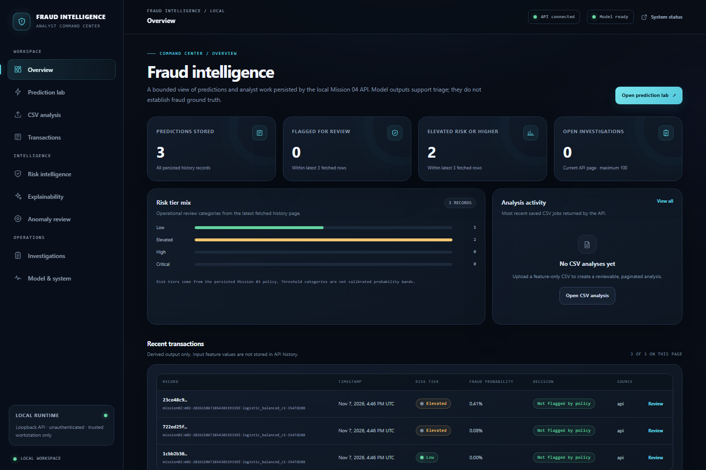

# AI Fraud Detection & Explainable Intelligence

An end-to-end fraud analytics system built on verified historical data. It combines a frozen calibrated classifier, explainability and separate anomaly signals with a local FastAPI service, SQLite analyst workflows, and a responsive Next.js command center.

## Business and scientific objective

Help analysts examine historical transaction labels, compare candidate detections, inspect estimated risk, and understand model outputs. The product must keep confirmed historical labels separate from predictions, risk estimates, anomaly scores, and explanations. A score or outlier is not proof of fraud.

## Current status

Missions 01–06 are complete for a local portfolio demonstration. The application uses the frozen Mission 02 classifier and Mission 03 risk, anomaly, and explanation services through a local FastAPI API; SQLite stores derived predictions and analyst workflow records. Mission 06 added nonce-based CSP and security headers, clarified investigation semantics, improved contrast, a safe production-demo launcher and shutdown script, complete local browser coverage, and portfolio evidence. The consumed Mission 02 final-test period was not reopened. The service remains unauthenticated and loopback-only; this is not a production banking system. Raw data, model binaries, SQLite runtime files, virtual environments, and credentials are excluded from Git.

## Portfolio overview

The screenshot is an authentic local browser capture. Its inputs are synthetic and its model outputs are estimates for review, not confirmed fraud. The system does not retain submitted feature vectors in prediction history.

- **Prediction and review:** single and bounded batch inference, calibrated probability, frozen decision threshold, risk tiers, and persisted derived history.
- **Explainability:** local and global SHAP views in raw log-odds, with screen-reader data tables.
- **Separate signals:** alert prioritization and Isolation Forest anomaly outputs remain distinct from the fraud probability.
- **Analyst workflow:** feature-only CSV analysis, paginated results, investigation status transitions, notes, and workflow events.
- **Scientific boundary:** ULB descriptive findings and Mission 02 test metrics are historical; neither is live production performance.

See the [project showcase](docs/portfolio/project-showcase.md), [architecture and flow diagrams](docs/architecture/mission06-architecture.md), [demo walkthrough](docs/portfolio/demo-script.md), [browser test results](docs/release/e2e-results.md), [release checklist](docs/release/release-checklist.md), and [Mission 06 release evidence](docs/release/final-audit.md). Supporting evidence: [security](docs/release/security-review.md), [accessibility](docs/release/accessibility-report.md), and [performance observations](docs/release/performance-report.md).

## Architecture

- src/fraud_detection: schema contract, loading, profiling, analytics, plots, report generation, ML training, evaluation, persistence, inference, explainability, and risk services.
- scripts: Windows setup, checks, acquisition, and execution entry points.
- notebooks: analytical narratives that call the reusable package.
- data/raw: local source datasets, excluded from Git.
- reports: reproducible EDA and ML reports, tables, and figures; fixture outputs are kept separate.
- backend: Mission 04 local FastAPI routes, SQLite persistence, Alembic migrations, and bounded upload workflows.
- frontend: Mission 05 Next.js App Router application using typed contracts and the documented local OpenAPI service.

See docs/architecture/system-overview.md.

## Technology

Python 3.11.8, NumPy, pandas, SciPy, scikit-learn, SHAP 0.51.0, joblib, FastAPI, SQLAlchemy, Alembic, Uvicorn, HTTPX, Matplotlib, Seaborn, pytest, and Ruff; Node.js 20.19.6, Next.js 16.4.5, React 19.3.0, TypeScript 5.9.3, Vitest, and Playwright. No PyTorch, TensorFlow, GPU, cloud service, or tracking server is required.

## Dataset

The primary dataset is the ULB Credit Card Fraud Detection dataset distributed on Kaggle. Its locally acquired file passed the ulb-credit-card-v1 schema check: 284,315 Class 0 and 492 Class 1 rows, 31 numeric fields, no nulls or infinities, and 1,081 duplicate copies beyond first. Time is elapsed seconds; V1–V28 are anonymized PCA-derived fields. See docs/data/data-quality-report.md, docs/data/data-dictionary.md, and reports/EDA_REPORT.md.

## Setup

PowerShell from the project root:

    .\scripts\setup.ps1
    .\.venv\Scripts\Activate.ps1

CMD from the project root:

    powershell -NoProfile -File scripts\setup.ps1
    .venv\Scripts\activate.bat

The setup creates a project-local .venv and installs the resolved Windows/Python 3.11 dependency set from requirements-mission04.lock. Mission 01–03 lock files are retained as historical environment records. pyproject.toml remains the dependency constraint source. If Windows blocks running a local PowerShell script, use a one-process execution policy option rather than changing a machine-wide policy:

    powershell -NoProfile -ExecutionPolicy Bypass -File scripts\setup.ps1

The policy option applies only to that PowerShell process.

## One-Click Windows Launch

On Windows 11, double-click `START_AI_FRAUD.bat` in File Explorer. The launcher uses the bundled
Windows PowerShell 5.1 with execution-policy bypass limited to that child process; it does not
change the machine or user execution policy and does not request administrator rights. It checks the
Python environment, Node.js, installed dependencies, production build, model artifacts, ports, and
database readiness before reporting success. It opens the dashboard in the Windows default browser
only after the API `/api/v1/ready` endpoint and frontend HTTP response pass.

The one-click demo uses `127.0.0.1:8001` for FastAPI and `127.0.0.1:3100` for the dashboard. It
reuses `data/backend/mission06-demo.sqlite3` and does not retrain models or delete data. Starting a
second time validates and reuses the existing session instead of starting duplicate services.
The batch entry point uses Windows PowerShell 5.1; the internal startup and stop scripts also support
PowerShell 7.
Double-click `STOP_AI_FRAUD.bat` to stop only the recorded launcher processes. It verifies each
process ID, executable path, and start time; repeated stops are safe. The SQLite database, uploads,
and model artifacts are preserved.

### Requirements before first launch

- Python 3.11 virtual environment at `.venv-isolated` or `.venv`.
- Node.js 20.9 or newer, installed frontend dependencies, and an existing production build at
  `frontend/.next` configured for `http://127.0.0.1:8001/api/v1`.
- Verified local model and explainability artifacts under the ignored `data/models/` directory.

The launcher checks dependencies but does not install or update them. For a fresh clone, follow
the setup instructions above, install the locked frontend dependencies, and build the frontend once
with `NEXT_PUBLIC_FRAUD_API_URL=http://127.0.0.1:8001/api/v1`. After that preparation, startup and
shutdown require only the two batch files.

### Common launch errors

- **Python environment missing or package import fails:** run the documented Python setup and
  dependency installation, then launch again.
- **Node.js or Next.js dependencies missing:** install Node.js 20.9+ and the locked packages under
  `frontend/`; the launcher never installs them automatically.
- **Production build missing or API URL mismatch:** rebuild the frontend with the API URL shown
  above. The launcher will not serve a bundle configured for a different API.
- **Port 8001 or 3100 is occupied:** the launcher leaves the owning process untouched. Stop that
  application using its own controls, then retry.
- **Model artifact verification or SQLite migration fails:** inspect
  `data/backend/mission06-demo-logs/`. Do not delete the database or model artifacts as a repair.
- **Startup timeout or partial session:** inspect the log folder and double-click
  `STOP_AI_FRAUD.bat` before retrying. It acts only on processes whose saved identity still
  matches.
- **Browser does not appear:** if the default browser handler cannot be invoked, open the printed
  dashboard URL after the launcher confirms readiness.

Timestamped launcher, API, and frontend logs live under the Git-ignored
`data/backend/mission06-demo-logs/`. The demonstration should use only the synthetic feature-only
fixture at `docs/portfolio/fixtures/synthetic-demo-transactions.csv`; it contains no target labels
and is not fraud ground truth. See the [demo walkthrough](docs/portfolio/demo-script.md).

## Dataset acquisition

The acquisition script uses the official Kaggle CLI and credentials already configured locally. It never displays credentials, leaves incomplete files behind, refuses to replace an existing file, validates schema and labels, records file size and SHA-256, and writes provenance metadata beside the ignored raw file. Kaggle CLI is a one-time acquisition tool and is not a project runtime dependency.

    .\.venv\Scripts\python.exe -m pip install kaggle
    .\.venv\Scripts\python.exe scripts\download_dataset.py

For a fresh clone without the local ignored CSV, install Kaggle CLI and configure authorized credentials locally before acquisition. Never put credentials in this repository or chat. The script will fail safely if the CLI, credentials, or network are unavailable.

## Run EDA

After acquiring and validating the dataset:

    .\scripts\run-eda.ps1

Or run from CMD:

    .venv\Scripts\python.exe -m fraud_detection.eda --dataset data\raw\creditcard.csv --output-dir reports

The report generator writes EDA_REPORT.md, a JSON summary, quality profile, numerical tables, and a bounded set of figures. To smoke-test without real data, explicitly run:

    .\.venv\Scripts\python.exe -m fraud_detection.eda --synthetic-demo --output-dir reports

Fixture output goes under reports/demo and is not ULB evidence.

Key generated outputs include reports/EDA_REPORT.md, reports/figures/, reports/tables/, reports/summaries/eda_summary.json, and reports/summaries/data_quality_profile.json.

## Checks

PowerShell:

    .\scripts\run-checks.ps1

To run the same checks with another interpreter, including a fully isolated environment:

    .\scripts\run-checks.ps1 -PythonPath .venv-isolated\Scripts\python.exe

CMD:

    .venv\Scripts\python.exe -m pytest
    .venv\Scripts\python.exe -m ruff check .
    .venv\Scripts\python.exe -m ruff format --check .
    .venv\Scripts\python.exe -m compileall -q src scripts tests backend
    .venv\Scripts\python.exe scripts\validate_notebooks.py

Routine pytest and CI do not require the local CSV. To run the opt-in real-data integration check:

    $env:RUN_REAL_DATA_TESTS = "1"
    .\.venv\Scripts\python.exe -m pytest -m real_data -q
    Remove-Item Env:RUN_REAL_DATA_TESTS

Mission 04's separate artifact integration checks the verified local models with synthetic
requests and does not read the ULB CSV:

    $env:RUN_MISSION04_ARTIFACT_TESTS = "1"
    .\.venv-isolated\Scripts\python.exe -m pytest -m mission04_real_artifacts -q
    Remove-Item Env:RUN_MISSION04_ARTIFACT_TESTS

## Mission 02 machine learning

The package entry point is fraud-ml. For a new, declared experiment, first freeze the verified chronological split and then run the bounded training/evaluation workflow:

    .\.venv\Scripts\python.exe -m fraud_detection.ml.cli prepare
    .\scripts\train-models.ps1

Training selects from expanding temporal folds inside the training partition, fits sigmoid calibration from training-only out-of-fold scores, selects the F2 threshold on validation, and then scores the final time window. Because this workflow evaluates the final test, do not rerun it to make development decisions; Mission 02's final period is now consumed. The duplicated completion evaluation used to repair missing anomaly-artifact persistence is documented in the leakage audit.

Inspect already saved aggregate results without retraining:

    .\scripts\evaluate-models.ps1

Verify the local supervised and anomaly artifacts:

    .\scripts\verify-model-artifacts.ps1

Saved results, the split manifest, reports, and figures are under reports/ml/. Joblib model files are local under data/models/ and ignored by Git. Only load trusted local artifacts created by this project; joblib deserialization can execute code.

Key documentation:

- docs/ml/data-splitting.md and docs/ml/leakage-prevention.md
- docs/ml/modeling-strategy.md and docs/ml/model-selection.md
- docs/ml/calibration-and-thresholds.md and docs/ml/anomaly-detection.md
- docs/ml/reproducibility.md
- docs/engineering/mission-03-handoff.md
- reports/ml/FINAL_MODEL_REPORT.md and reports/ml/MODEL_COMPARISON.md

## Mission 03 explainability and risk intelligence

Mission 03 reuses the frozen model and threshold without retraining. Exact contribution checks and
SHAP explain raw logistic log-odds; the later calibrated probability is a separate mapping.
Validation-derived risk tiers and review-capacity tables are descriptive, while the Isolation
Forest remains a separate non-probability signal. No final-test rows or labels enter this mission.

Generate the global/local explanation reports, risk diagnostics, and figures:

    powershell -NoProfile -ExecutionPolicy Bypass -File scripts\generate-explanations.ps1

Score a bounded feature CSV, optionally including anomaly intelligence or linear explanations:

    powershell -NoProfile -ExecutionPolicy Bypass -File scripts\analyze-risk.ps1 -InputPath path\to\features.csv -IncludeAnomaly

Run synthetic Mission 03 tests, or opt into the trusted local development-data integration:

    powershell -NoProfile -ExecutionPolicy Bypass -File scripts\validate-explainability.ps1
    powershell -NoProfile -ExecutionPolicy Bypass -File scripts\validate-explainability.ps1 -RealData

The generated reports live under reports/explainability/ and reports/risk/. The notebooks
10–14 summarize those outputs without repeating model logic. The training-only anomaly reference
is derived locally under ignored data/models/ and can be rebuilt by the generation script.

## Mission 04 local API

The backend reuses the checked Mission 02/03 manifests and local ignored artifacts; it does not
retrain or open the source CSV at startup. Initialize the SQLite schema and start one loopback
server from PowerShell:

    .\scripts\start-api.ps1 -PythonPath '.venv-isolated\Scripts\python.exe'

The API is available at `http://127.0.0.1:8000`; OpenAPI documentation is at `/docs`. Run focused
synthetic API checks, a live HTTPX smoke, or trusted-artifact verification with:

    .\scripts\run-api-checks.ps1 -PythonPath '.venv-isolated\Scripts\python.exe'
    .\scripts\smoke-api.ps1 -PythonPath '.venv-isolated\Scripts\python.exe'
    .\scripts\verify-api-artifacts.ps1 -PythonPath '.venv-isolated\Scripts\python.exe'

Routes, schema, data handling, security boundaries, and the investigation workflow are documented
under `docs/backend/`. This API is unauthenticated and single-user; it is not suitable for LAN or
production exposure.

Mission 04 local validation completed on 2026-11-07. The isolated full-project check reported 78
passed and 4 expected opt-in skips; all 14 notebooks executed and the synthetic EDA smoke wrote only
under ignored `reports/demo/`. The focused API suite reported 15 passed and its opt-in artifact test
reported 1 passed. A real HTTPX run against a temporary local Uvicorn server verified 30 endpoint
operations. Full results, observed latency, migration behavior, and limitations are in
`PROGRESS.md`.

## Mission 05 analyst frontend

The responsive dashboard lives in `frontend/` and communicates with the loopback API at
`http://127.0.0.1:8000/api/v1`. It includes overview, single and batch prediction, feature-only CSV
analysis and paginated results, transaction history, persisted risk policy and alert prioritization,
global and local explainability, separate anomaly scoring, investigation workflows, and system
status. It does not use fallback analytics or fabricate history. See `docs/frontend/` for the
architecture, API mapping, design system, page workflows, accessibility notes, testing, and local
development.

With Node.js 20.19.6 and the isolated Python environment installed, start both loopback services
with `scripts/start-fullstack.ps1 -PythonPath '.venv-isolated\Scripts\python.exe'`, or start them
separately with `scripts/start-api.ps1` and `scripts/start-frontend.ps1`. The frontend defaults to
port 3000 and can use port 3100 if 3000 is occupied. Run `scripts/run-frontend-checks.ps1` for
TypeScript, ESLint, Vitest, and production build checks; run `scripts/smoke-frontend.ps1` for local
API/frontend health and Playwright workflows. Install the matching browser once with
`npx playwright install chromium` from `frontend/` before browser tests.

Historical Mission 05 validation on 2026-11-07 reported 81 backend tests passed and 4 expected
opt-in skips; the separate ULB integration reported 2 passed, 1 separately gated skip, and 82
deselected. All 14 notebooks executed. Frontend validation reported 16 unit tests passed, a
successful optimized build, 8 browser tests passed, and zero axe WCAG 2.1 A/AA or best-practice
violations across nine routes at desktop and mobile widths. Full evidence and remaining hardening
limits are preserved in `PROGRESS.md` and `docs/engineering/mission-06-handoff.md`. Mission 06
revalidated the safe backend checks, reran the frontend build and expanded browser suite, and
records the final evidence under `docs/release/`.

## Six-mission roadmap

1. Foundation, dataset validation, data engineering, and EDA — complete.
2. Supervised machine learning, evaluation, and anomaly detection — complete.
3. Explainable AI and risk intelligence — implemented and validated; see PROGRESS.md.
4. FastAPI backend — implementation and local validation complete; GitHub delivery is recorded in PROGRESS.md.
5. Next.js frontend and local integration — implementation and validation complete; GitHub delivery is recorded in `PROGRESS.md`.
6. Security, accessibility, performance, local demo, and portfolio delivery — complete for a
   loopback-only demonstration. Authentication, a network deployment, and production readiness are
   explicitly out of scope.

## Scientific limitations

- V1–V28 are anonymized PCA components; they have no direct business names or causal meaning.
- Time is elapsed seconds from the first transaction in this dataset, not a calendar timestamp.
- The data has no supplied customer, merchant, location, or device history.
- Accuracy can conceal poor minority-class detection; later model evaluation must include precision-recall and threshold-specific measures.
- The chosen model and threshold have only been evaluated on one short historical dataset. The final test is no longer an untouched set because it was scored in two deterministic completion runs; independent future evaluation requires new later data.
- The selected model is not production-ready. There is no future-period validation, authenticated or network-deployed service, monitoring, encryption-at-rest, or business-cost analysis. Mission 04's unauthenticated API is local-only.
- Licensing and permitted redistribution must be checked at the source before sharing dataset contents.
