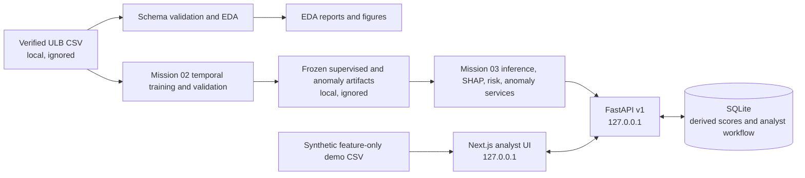
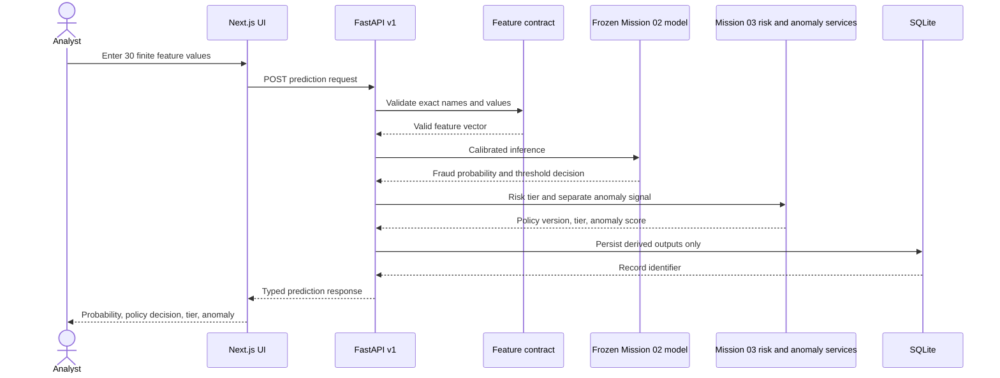
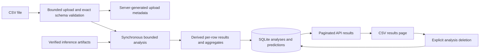
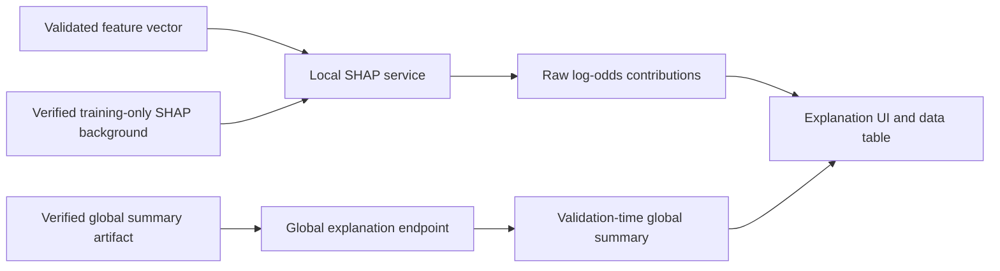
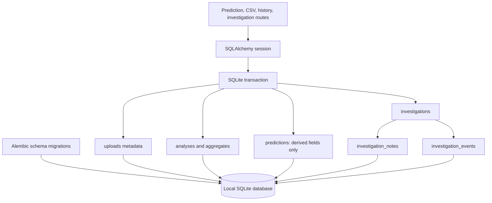
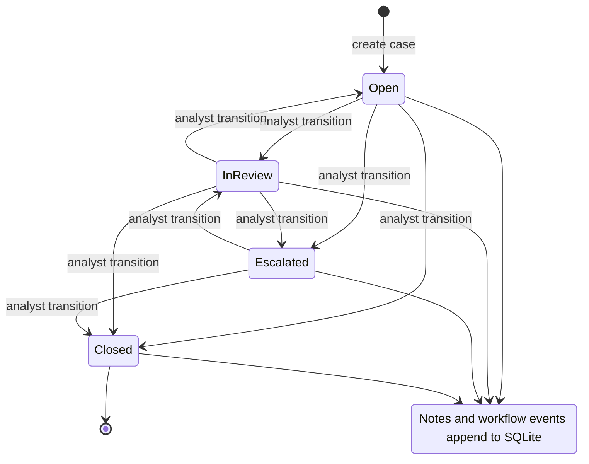

# Mission 06 architecture and data flows

These diagrams describe the implemented local application. Training is an offline, completed workflow; API requests load verified artifacts and do not retrain or read the raw ULB dataset.

## System architecture

The UI submits exact feature vectors to the API. SQLite stores derived prediction fields, analysis summaries/results, upload metadata, and investigation activity. Submitted feature values are not stored in prediction history. Raw source data, trained model binaries, and local runtime databases remain outside Git.

## Single prediction

The decision threshold is frozen at `0.1835921396957453`. A predicted flag is a review signal, not a confirmed-fraud label. Anomaly scores are not probabilities and are never blended into the classifier probability.

## Feature-only CSV analysis

The API enforces a 32 MiB upload cap and 20,000-row cap by default, validates the feature-only schema, assigns a server-generated filename, and expires uploads after 24 hours. CSV output is a prediction workflow, not an evaluation against labels. The synthetic fixture has 30 rows and no target column.

## Explainability

Local and global explanation values are raw log-odds contributions. They are not percentage-point changes in the later calibrated fraud probability and are not causal explanations. Global attribution is based on the persisted development-time summary; it is not recomputed from the final-test partition.

## SQLite persistence

Startup verifies Alembic revision `0002_prediction_semantics`. Foreign keys and indexes support analysis deletion, transaction history, risk-tier filters, and case lookups. A synchronous analysis interrupted by a process restart is marked failed rather than reported as completed. The database is local and not encrypted at rest.

## Investigation workflow

Analyst-recorded outcomes are workflow annotations. The API does not create adjudicated ground truth or claim analyst identity.
