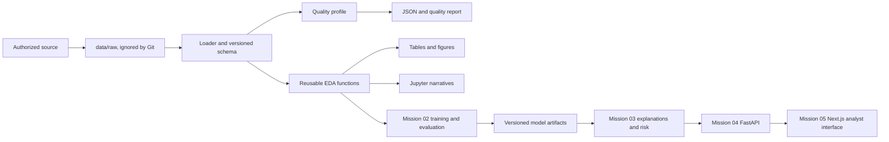

# System Overview

## Project vision

The six-mission product gives financial analysts a reproducible way to inspect transaction data, compare validated model outputs, review explanations, and prioritize investigation. Historical labels, predictions, risk scores, anomaly scores, and explanations are separate outputs. None is proof of fraud.

## Layer responsibilities

- Raw data boundary: local source files under data/raw, read-only for the analysis pipeline, never committed.
- Data and analytics package: src/fraud_detection handles loading, explicit schema validation, profiling, statistics, charts, and report serialization.
- Notebooks: analytical narratives import the package and display source status and interpretation limitations.
- Scripts: Windows-compatible setup, acquisition, checks, and repeatable CLI entry points.
- Reports: compact figures, tables, and summaries generated from a declared source.
- Training/evaluation: reserved for Mission 02; preprocessing is fit only on training folds.
- Explainability/risk: reserved for Mission 03; explanations are constrained by input semantics.
- API: Mission 04 wraps tested services in versioned FastAPI routes.
- Frontend: Mission 05 consumes API contracts and labels output types clearly.

## Data flow

## Training versus inference

Mission 01 does not train models. Mission 02 will separate fit-time transformations and model selection from inference-time loading and scoring. Training metadata, feature contract, model version, and threshold rationale must travel with model artifacts. The future test partition remains untouched until final evaluation.

## Integration and artifacts

Reusable services take DataFrames or validated schemas rather than notebook globals. Model binaries live in a local artifact store and are versioned by metadata; raw datasets and large binaries remain outside Git. The API should expose predictions, risk estimates, anomaly scores, and explanations with distinct typed fields.

## Configuration

Use project configuration and explicit CLI arguments. Keep secrets in an authorized local credential store/environment, never in committed files. Avoid machine-wide settings. Seeds and time-bin parameters must be declared.

## Security and privacy

Read raw files without mutation, avoid unnecessary transaction-level exports, and keep credentials out of logs and provenance reports. Review dataset terms before redistributing any data or derived extracts. The public sample does not justify claims about customers, locations, merchants, or devices.
