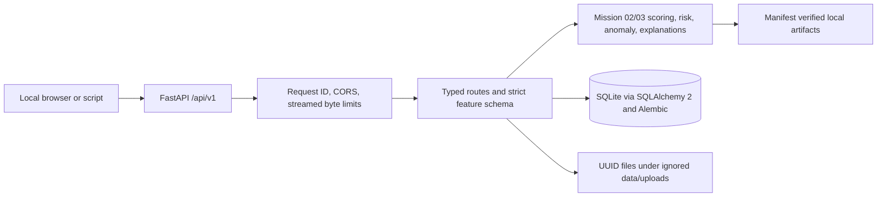

# Mission 04 backend architecture

The local API is implemented in `backend/app`; it calls the existing reusable services in
`src/fraud_detection` and does not train, recalibrate, or refit anything at request time.

## Lifecycle

- The process binds to `127.0.0.1` by default. `Settings` rejects non-loopback bind addresses and
  wildcard CORS configuration.
- Startup verifies model, anomaly, risk policy, anomaly reference, SHAP background, and global
  summary provenance from checked-in manifests. Joblib files are loaded only from those manifest
  paths. Liveness remains available if artifacts or database migrations are unavailable; readiness
  returns a sanitized 503 until both are ready.
- The supervised probability, risk tier, separate anomaly score, and explanation retain their
  Mission 02/03 meanings. No request triggers retraining or validation-policy fitting.
- CSV analyses are synchronous, bounded at 20,000 rows by default, and processed in 256-row
  chunks. A process-local semaphore defaults to one active analysis. Startup marks jobs left in
  `pending` or `running` as failed with `analysis_interrupted_by_restart`; they are not resumed.
- Database records retain derived scores and aggregate summaries, never the 30-value feature
  vectors. Uploads use server-generated UUID filenames and default to 24-hour file retention.

## Module boundaries

- `backend/app/core`: local configuration, request IDs, and streaming request-byte guard.
- `backend/app/db`: declarative records, foreign-key enabled SQLite engine, and request sessions.
- `backend/migrations`: explicit Alembic upgrade-only schema history.
- `backend/app/services`: manifest-pinned model startup and strict CSV parsing.
- `backend/app/main.py`: versioned HTTP routes and bounded orchestration.
- `scripts`: Windows initialization, launch, checks, artifact verification, and live HTTP smoke.

The API uses one process-local model and SHAP explainer. Run one worker for this local setup; a
multi-worker deployment would require a separately designed concurrency and persistence policy.
