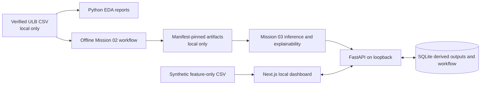
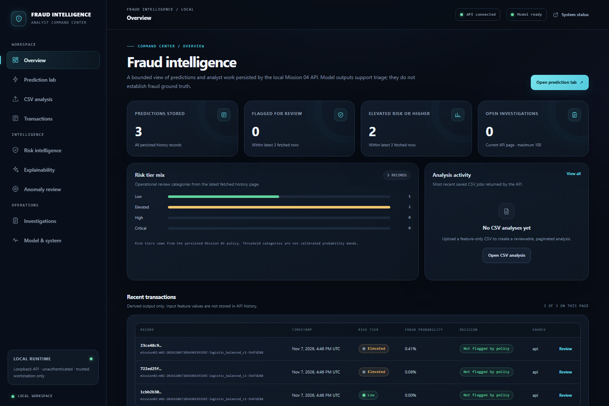
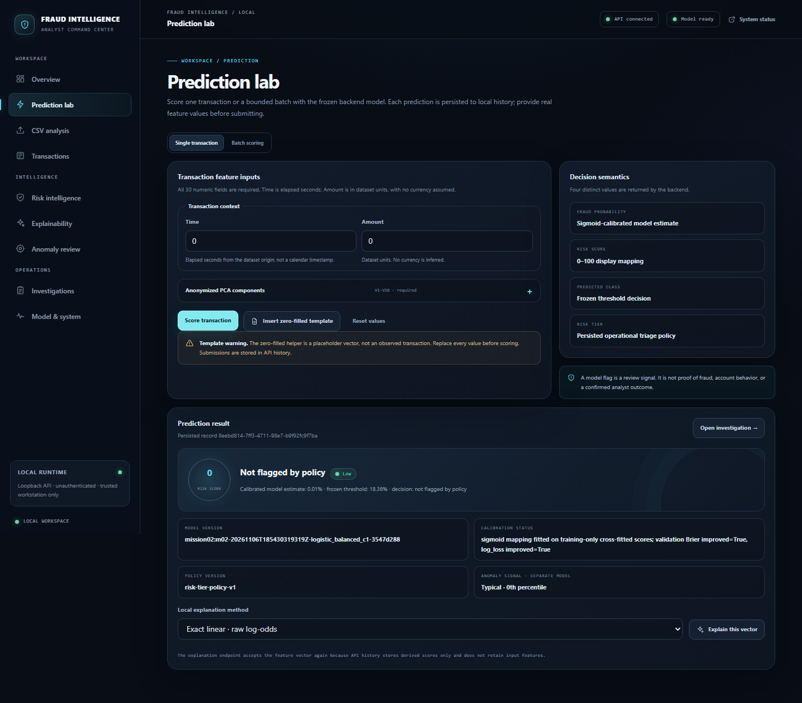
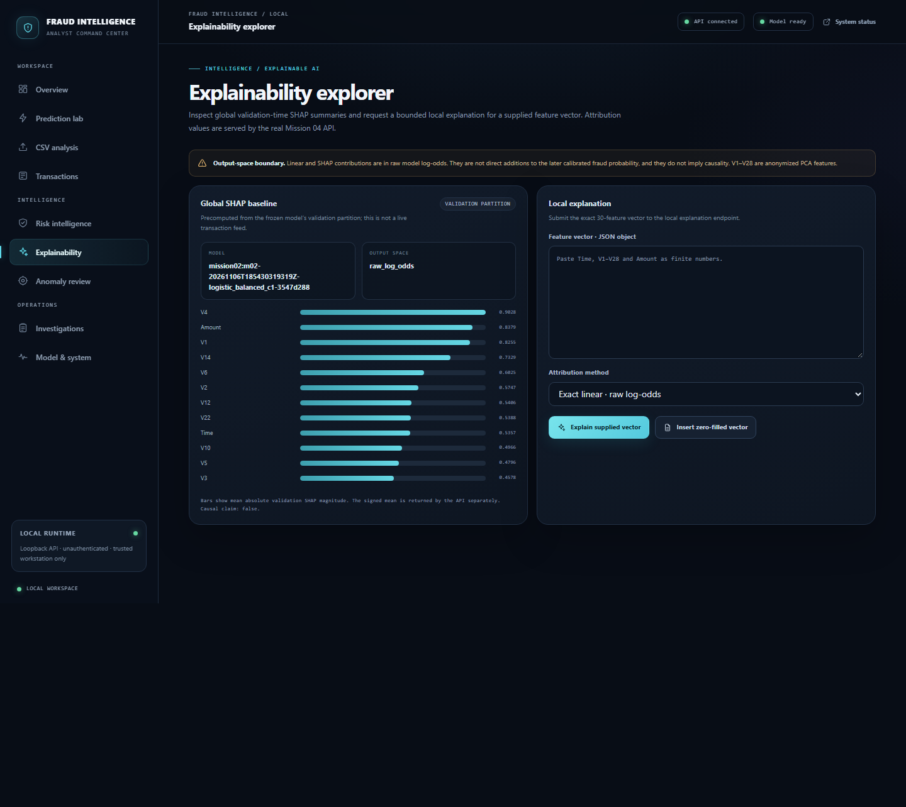
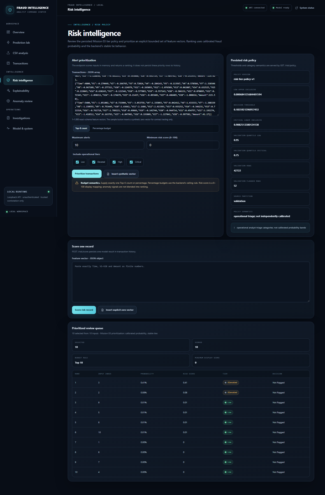
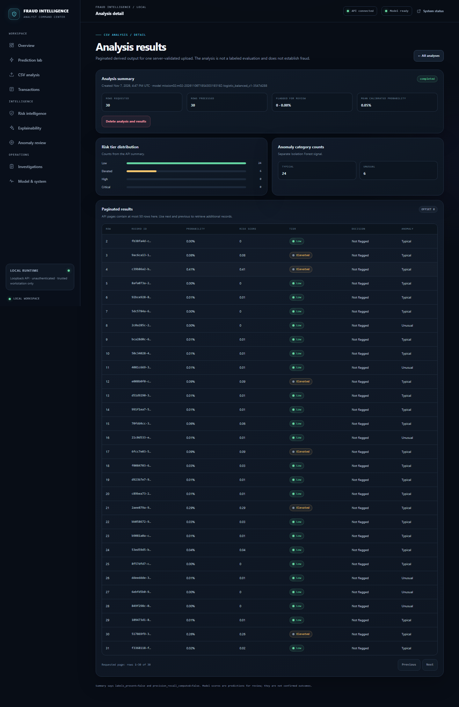
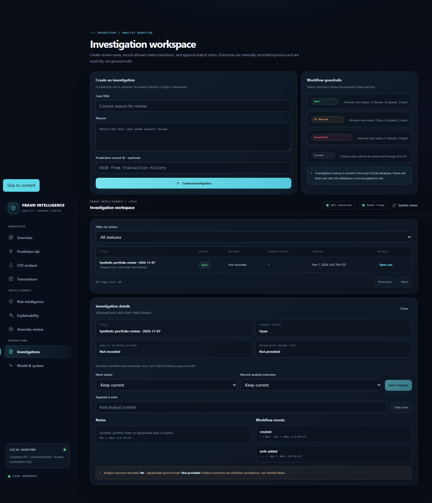
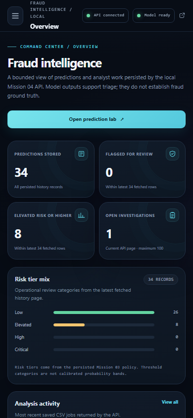

# AI Fraud Detection & Explainable Intelligence

## Project overview

This six-mission project turns a historical, highly imbalanced credit-card dataset into a
reproducible analytics and local analyst-review workflow. It combines descriptive EDA, a frozen
calibrated classifier, separate anomaly and risk signals, raw-log-odds explanations, a typed local
API, SQLite workflow records, and a responsive Next.js interface.

The release is a portfolio demonstration. Predictions, risk tiers, anomaly scores, SHAP attributions,
and analyst-entered outcomes are distinct fields with different meanings. None of them is proof of
fraud, and the synthetic screenshots are not customer outcomes.

## What the system demonstrates

- Reproducible source validation and EDA with explicit provenance and data-quality reporting.
- Chronological model evaluation, threshold selection, calibration, versioned artifacts, and
  disclosure that the final-test period was scored twice during artifact-persistence repair.
- Exact linear contribution checks and SHAP explanations in raw log-odds, separate from calibrated
  probability.
- Validation-derived risk tiers and a separate Isolation Forest anomaly signal.
- Bounded prediction and feature-only CSV analysis through a local FastAPI service.
- Derived-only prediction history and a SQLite-backed investigation workflow.
- Clear loading, validation, offline, and service-recovery states in the responsive UI.
- A repeatable production-bundle demo launcher that uses loopback, verifies artifacts and ports,
  tracks its own processes, and preserves local demo records on shutdown.

## Architecture

See the [detailed architecture diagrams](../architecture/mission06-architecture.md) for prediction,
CSV analysis, explanation, persistence, and investigation flows.

## Evidence

- Python regression: **81 passed, 4 expected skips**; safe verified-artifact integration: **1 passed**.
- Frontend: TypeScript and ESLint passed; **16 Vitest tests** passed; optimized build passed.
- Browser: **14 Playwright tests passed**; 36 responsive route/viewport combinations had no
  horizontal overflow; 18 axe scans reported zero configured violations.
- Python dependency advisory scan: **0 known vulnerabilities** across 111 installed packages.
  Production npm audit: **0 vulnerabilities**; the full development tree retains 10 moderate
  `minimatch` advisories.
- Local latency and synthetic CSV timings are reported with their limitations in the
  [performance report](../release/performance-report.md).

Full evidence and caveats are in the [final audit](../release/final-audit.md), [security review](../release/security-review.md),
[accessibility report](../release/accessibility-report.md), and [browser results](../release/e2e-results.md).

## Screenshot gallery

Every screenshot is a local browser capture from a synthetic demo run. It contains no ULB
transaction row or fraud ground truth.

## Local demonstration

Install project dependencies and build the frontend as described in the README. Run
`.\scripts\start-demo.ps1`, open the printed dashboard URL, and follow the
[demo walkthrough](demo-script.md). The default ports are API 8001 and UI 3100. Use only the
included synthetic feature-only fixture for the CSV workflow. The stop helper preserves the local
SQLite database and uploads.

## Limits

The ULB data is historical and anonymized. It has no customer, merchant, device, or location
history. The final-test partition is consumed; independent future evaluation requires a later
labeled cohort. The API has no authentication or authorization and must remain loopback-only.
SQLite is not encrypted at rest. No production deployment, screen-reader certification, concurrent
load test, peak-memory measurement, or business-impact claim is made.
