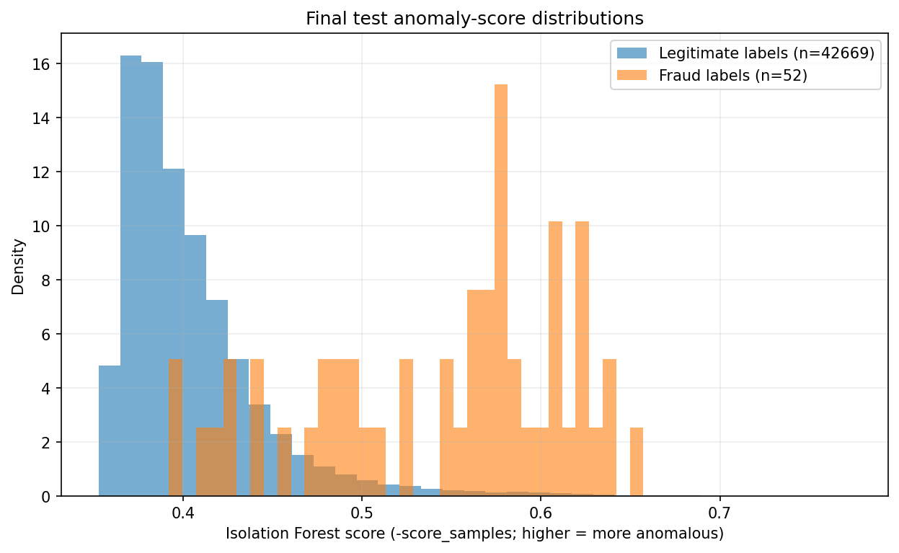

# Isolation Forest anomaly experiment

Isolation Forest was fitted on Class 0 rows from the training partition only; labels were used to define this known-legitimate fit subset and only to evaluate ranking. Higher `-score_samples` means more anomalous. The score is continuous and is **not a fraud probability**.

- Fit rows: **198,980 legitimate transactions**
- Input features: **unscaled numeric ULB fields; `Class` excluded**
- Saved artifact: `data\models\m02-20261106T185430319319Z-logistic_balanced_c1-3547d288-isolation-forest.joblib`
- Artifact SHA-256: `e5c071d8e39a013f1ebacac600109633b15bc97fc43f64d085662399b5dc6d60`
- Validation Average Precision / ROC-AUC: **0.02883 / 0.94776**
- Final-test Average Precision / ROC-AUC: **0.03845 / 0.94518**

Unusual transactions are not necessarily fraudulent; many fraud cases may also resemble common transactions. Scores are not combined with supervised probabilities.

## Top-ranked overlap with the supervised model

Overlap is descriptive and does not combine or recalibrate score scales.

| Alert budget | Validation overlap of K | Final-test overlap of K |
|---:|---:|---:|
| 0.1% | 4.65% | 6.98% |
| 0.5% | 15.89% | 19.16% |
| 1% | 19.86% | 21.73% |

