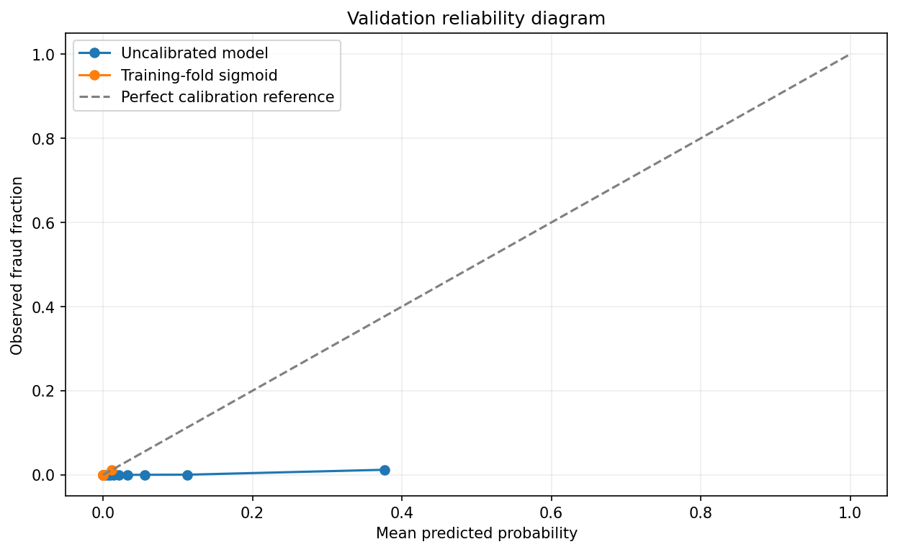
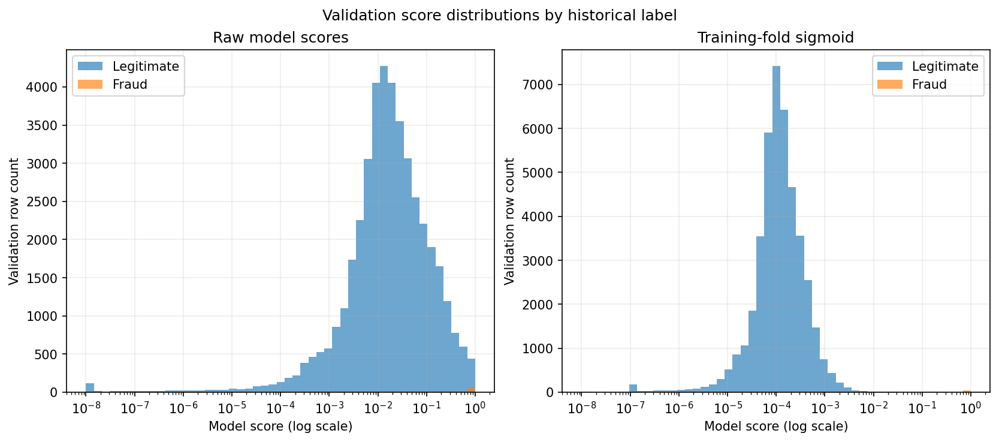

# Probability calibration

The selected estimator's sigmoid (Platt) mapping was fitted to training-only held-out fold scores. Validation data was used for assessment, not for fitting the mapping. Isotonic calibration was not fit because the limited positive count makes a flexible mapping prone to overfit.

| Method | Brier score | Log loss | Equal-frequency ECE |
|---|---:|---:|---:|
| Raw estimator | 0.0196 | 0.0876 | 0.0619 |
| Training-fold sigmoid | 0.0004 | 0.0022 | 0.0002 |

Validation probability quantiles (minimum, median, p90, p99, maximum):

- Raw model scores: `{'min': 1.5441610983221395e-25, 'median': 0.017008065076879422, 'p90': 0.16696566923164746, 'p99': 0.7134220893409929, 'max': 0.9999999999999873}`
- Training-fold sigmoid: `{'min': 1.286345779459383e-07, 'median': 0.00011480230055557788, 'p90': 0.00045611879445793877, 'p99': 0.0018827402527598716, 'max': 0.9082513380124138}`

Brier improvement: **True**. Log-loss improvement: **True**. The validation estimate uses 56 fraud rows and can be unstable. A mapped score is not automatically a reliable production probability.

