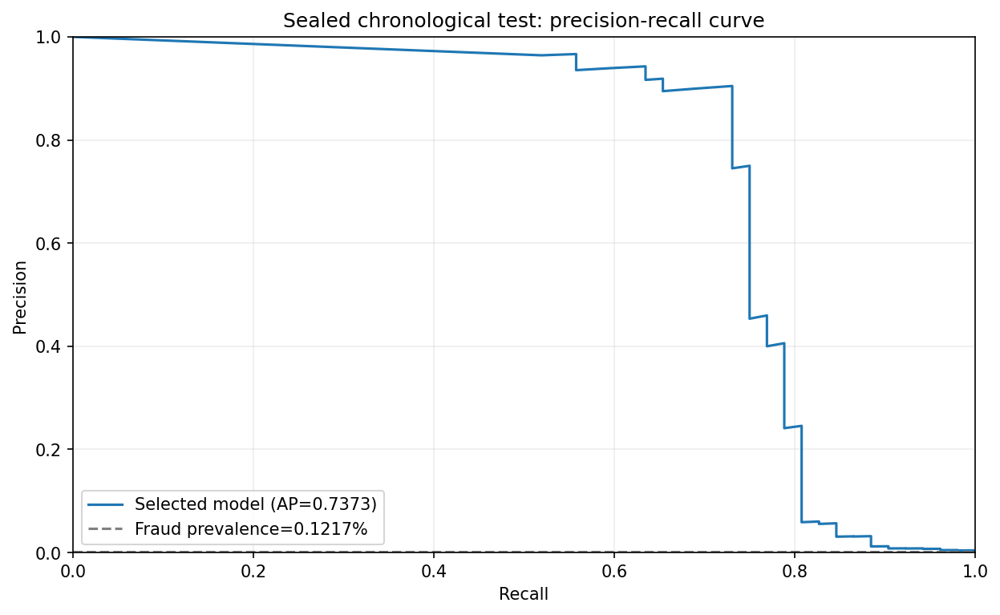
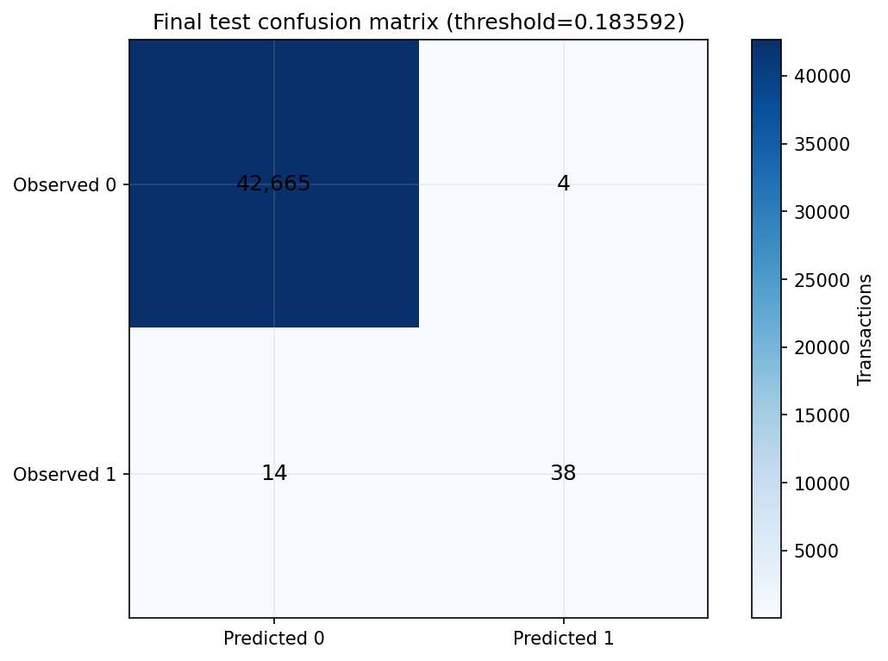
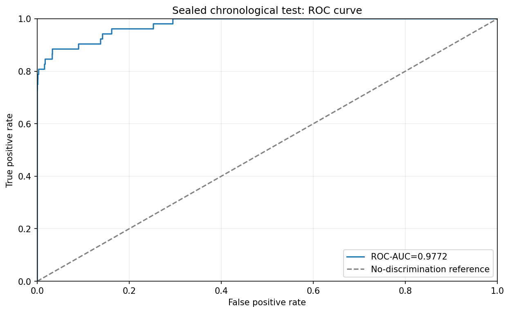

# Final supervised model report

**Selected model:** logistic_balanced_c1 (LogisticRegression)
**Threshold:** 0.18359214, selected by validation maximum F2
**Final-test rows:** 42,721; fraud labels: 52
**Dataset SHA-256:** `76274b691b16a6c49d3f159c883398e03ccd6d1ee12d9d8ee38f4b4b98551a89`
**Split manifest:** `3547d288e55133319d9ab6c50b2f3224322b942c6a35e9ef257dbaaaedd22330`

| Metric | Final chronological test |
|---|---:|
| Average Precision | 0.73727 |
| Trapezoidal PR area | 0.74608 |
| ROC-AUC | 0.97724 |
| Precision / recall | 0.90476 / 0.73077 |
| F1 / F2 | 0.80851 / 0.76000 |
| Brier / log loss | 0.000450 / 0.002851 |
| Confusion counts | TN=42,665, FP=4, FN=14, TP=38 |
| Alerts | 42 (0.098%) |

Recall's Wilson 95% interval is `[0.5974778016637287, 0.8323103970483349]`; this interval assumes independent Bernoulli outcomes and does not account for temporal dependence. The 52 fraud cases are too few for fine-grained certainty claims.

## Alert capacity

| Budget | K alerts | Supervised precision@K | Supervised recall@K | Isolation Forest recall@K |
|---:|---:|---:|---:|---:|
| 0.1% | 43 | 0.8837 | 0.7308 | 0.0000 |
| 0.5% | 214 | 0.1963 | 0.8077 | 0.2500 |
| 1% | 428 | 0.0981 | 0.8077 | 0.4808 |

## Limitations

The test window contains 52 fraud labels and covers only a short historical dataset period. V1–V28 are anonymous PCA components; Time is elapsed seconds with no calendar origin; no customer, merchant, location, or device history is available. Duplicate signatures did not cross the frozen partitions, but near-duplicate and entity leakage are not assessable. These results do not establish production readiness or future-month generalization.

## Local artifacts

- Supervised bundle: `data\models\m02-20261106T185430319319Z-logistic_balanced_c1-3547d288.joblib`
- Supervised bundle SHA-256: `87f0e2f492fbed062e38b366a2d98e2a98a655f7e1c81657cd6986c1874fa088`
- Isolation Forest: `data\models\m02-20261106T185430319319Z-logistic_balanced_c1-3547d288-isolation-forest.joblib`
- Isolation Forest SHA-256: `e5c071d8e39a013f1ebacac600109633b15bc97fc43f64d085662399b5dc6d60`
- Both joblib files are under ignored `data/models/` and must only be loaded from trusted local sources.
