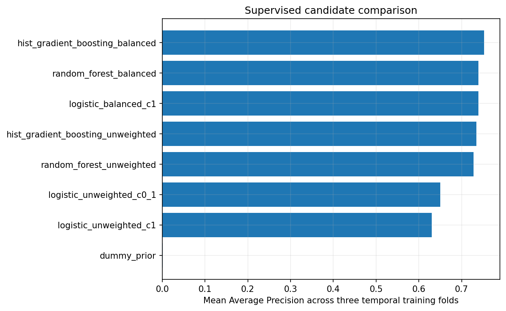

# Supervised model comparison

All candidates use the same three expanding-window folds inside the chronological training partition. Average Precision is the primary ranking metric; ROC-AUC is secondary. Fold results are noisy because one fold contains only 28 fraud examples. The winner is selected by the predeclared one-standard-error rule, preferring lower complexity.

### Training-fold selection metrics

| Candidate | Mean AP | Fold AP SD | Mean ROC-AUC | Fixed parameters |
|---|---:|---:|---:|---|
| hist_gradient_boosting_balanced | 0.75238 | 0.13229 | 0.96408 | {"class_weight": "balanced", "early_stopping": false, "l2_regularization": 1.0, "learning_rate": 0.08, "max_iter": 100, "max_leaf_nodes": 15, "random_state": 17} |
| random_forest_balanced | 0.73883 | 0.07586 | 0.93670 | {"class_weight": "balanced_subsample", "max_depth": 16, "max_features": "sqrt", "min_samples_leaf": 2, "n_estimators": 100, "n_jobs": 2, "random_state": 17} |
| logistic_balanced_c1 | 0.73880 | 0.08916 | 0.95674 | {"C": 1.0, "class_weight": "balanced", "scaler": "StandardScaler"} |
| hist_gradient_boosting_unweighted | 0.73463 | 0.15494 | 0.96759 | {"class_weight": null, "early_stopping": false, "l2_regularization": 1.0, "learning_rate": 0.08, "max_iter": 100, "max_leaf_nodes": 15, "random_state": 17} |
| random_forest_unweighted | 0.72793 | 0.12222 | 0.96065 | {"class_weight": null, "max_depth": 16, "max_features": "sqrt", "min_samples_leaf": 2, "n_estimators": 100, "n_jobs": 2, "random_state": 17} |
| logistic_unweighted_c0_1 | 0.65002 | 0.13424 | 0.95775 | {"C": 0.1, "class_weight": null, "scaler": "StandardScaler"} |
| logistic_unweighted_c1 | 0.63040 | 0.13256 | 0.95423 | {"C": 1.0, "class_weight": null, "scaler": "StandardScaler"} |
| dummy_prior | 0.00160 | 0.00107 | 0.50000 | {"strategy": "prior"} |

### Post-freeze validation comparison

These uncalibrated candidate scores use the fixed 0.5 reference threshold. They were computed after model and threshold selection was frozen and did not change the winner.

| Candidate | AP | ROC-AUC | Precision | Recall | F1 | F2 | FP | FN | Fit sec | Predict sec |
|---|---:|---:|---:|---:|---:|---:|---:|---:|---:|---:|
| dummy_prior | 0.00131 | 0.50000 | 0.0000 | 0.0000 | 0.0000 | 0.0000 | 0 | 56 | 0.0 | 0.001 |
| logistic_unweighted_c0_1 | 0.79263 | 0.98324 | 0.8333 | 0.5357 | 0.6522 | 0.5769 | 6 | 26 | 0.7 | 0.016 |
| logistic_unweighted_c1 | 0.78149 | 0.98240 | 0.7778 | 0.5000 | 0.6087 | 0.5385 | 8 | 28 | 0.8 | 0.023 |
| logistic_balanced_c1 | 0.83935 | 0.98276 | 0.0530 | 0.9286 | 0.1003 | 0.2158 | 929 | 4 | 1.0 | 0.019 |
| random_forest_unweighted | 0.85387 | 0.98282 | 1.0000 | 0.6786 | 0.8085 | 0.7252 | 0 | 18 | 87.6 | 0.173 |
| random_forest_balanced | 0.87213 | 0.96186 | 1.0000 | 0.7143 | 0.8333 | 0.7576 | 0 | 16 | 56.4 | 0.142 |
| hist_gradient_boosting_unweighted | 0.77209 | 0.98469 | 0.9130 | 0.7500 | 0.8235 | 0.7778 | 4 | 14 | 2.4 | 0.082 |
| hist_gradient_boosting_balanced | 0.84943 | 0.98595 | 0.3769 | 0.8750 | 0.5269 | 0.6921 | 81 | 7 | 17.6 | 0.120 |

Selected: **logistic_balanced_c1** (LogisticRegression).

Selection: `one-standard-error rule; simplest candidate within one SE of maximum mean AP`.

AP is Average Precision, not trapezoidal PR area. Validation metrics use the stated fixed 0.5 reference and are not the selected operating threshold. The final test set did not take part in model selection.

