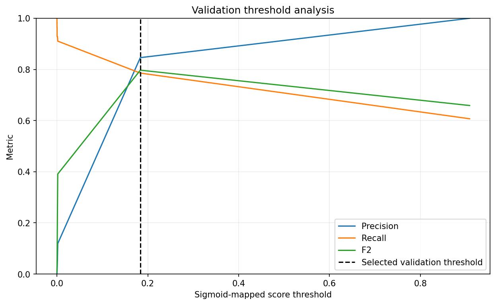

# Decision threshold analysis

The operating point maximizes F2 on the validation partition. This explicitly weights recall more than precision; it is a development objective, not an asserted business cost. No final-test labels were used.

- Selected threshold: **0.18359214**
- Validation precision / recall: **0.8462 / 0.7857**
- F1 / F2: **0.8148 / 0.7971**
- Alerts: **52 of 42,722 (0.122%)**
- False positives / missed fraud: **8 / 12**

Top-K tables use exactly `ceil(partition_rows × budget)` alerts; ties are broken by source row order. The threshold table contains a compact quantile grid plus the selected point.

